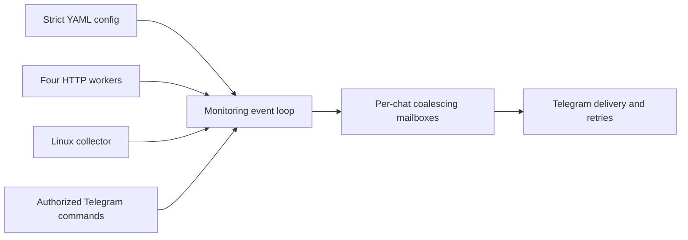

# pi-monitoring

A small Go monitor for a personal Linux server, with HTTP health checks, host
metrics and Telegram alerts. One process, a YAML configuration and no external
database. Targets Linux AMD64 and ARM64, including Raspberry Pi.

**Status: early runtime.** Incidents and pending notifications live in memory and
reset on restart. The dashboard, Docker integration, heartbeats and persistent
history are planned. Deployment acceptance and release verification remain open.

## Features

- HTTP status, text and typed JSON assertions using JSON Pointer. Exact numeric
  comparisons and rejection of ambiguous JSON, including duplicate keys.
- Linux CPU usage, memory, load, disk space and available CPU/SoC temperatures.
  Missing readings stay explicitly unavailable.
- HTTP incidents based on consecutive results; sustained host thresholds with
  recovery hysteresis to avoid noisy alerts.
- Telegram alerts and authorized status/check commands. Independent delivery
  retries coalesce pending state without blocking monitoring.
- Strict offline YAML validation and private config generation that preserves
  existing files. Credentials use explicit environment references.
- Foreground operation or the supplied systemd unit. Host reboot is a separate
  opt-in feature with an expiring, single-use confirmation.

## Try it

Build from a source checkout with Go 1.24 or later. Use a
[supported, patched Go release](https://go.dev/doc/devel/release#policy) for deployment.
Contributors must complete the source review in [CONTRIBUTING.md](CONTRIBUTING.md)
before executing project code or verification.

```sh
make build
./bin/pi-monitor init --output ./config.yaml --no-dashboard
./bin/pi-monitor validate --config ./config.yaml
./bin/pi-monitor run --config ./config.yaml
```

The generated config enables host monitoring and leaves Telegram and Docker off.
Press Ctrl+C to stop. These commands install no service. `make help` lists the
workflow; application Make targets use `./config.yaml` by default. Direct commands
otherwise default to `/etc/pi-monitor/config.yaml`.

For HTTP monitoring, adapt [examples/http.yaml](examples/http.yaml) to an endpoint
you control, then evaluate once:

```sh
./bin/pi-monitor validate --config examples/http.yaml
./bin/pi-monitor check example-api --config examples/http.yaml
```

`validate` needs no credentials and makes no network requests. `check` contacts
the selected endpoint and never sends Telegram notifications. Exit codes are
`0` for success, `1` for an operation/check failure and `2` for invalid usage or
configuration.

## Telegram and deployment

The [setup guide](docs/usage.md) covers bot creation, chat/user allowlists and
credential references. Keep the bot token in a private `secrets.env` beside the
config (mode 0600); it is read on launch, with process environment values taking
precedence. Keep one polling process per bot token.

| Command | Purpose |
| --- | --- |
| `/status` | Server overview, latest checks and incidents |
| `/host` | Host metrics with observation times |
| `/checks` | HTTP results, including stale/unknown state |
| `/check <id>` | Request an immediate check |
| `/incidents` | Current open incidents |
| `/help` | Command guide |
| `/reboot` | Opt-in host reboot with confirmation |

The bot registers its command menu on startup. Replies use plain text, readable
sections, units and UTC observation times; stale data never implies current
health. Alerts distinguish opening, ongoing and recovered incidents.

For background operation, follow [systemd setup](docs/usage.md#run-in-the-background-with-systemd).
`make install-service` uses sudo and enables startup at boot; `make start-service`
starts monitoring separately. Review the optional
[reboot permission](docs/usage.md#enable-server-reboot-from-telegram) before enabling it.

## Architecture



The runtime owns incident state in one event loop. Workers collect observations;
bounded channels and per-operation deadlines limit work. Packages follow actual
responsibilities: configuration, setup, HTTP evaluation, host collection, runtime
and Telegram transport. The sole direct dependency is `yaml.v3`.

Read [architecture and decisions](docs/architecture.md) for code navigation,
concurrency ownership, tradeoffs and resource limits. The
[product design](docs/design.md) describes the roadmap;
[implementation status](docs/implementation.md) identifies what exists today.

## Development and security

After independent source review:

```sh
make fmt
make test
make vet
make race
```

Tests use temporary directories, local HTTP/TLS fixtures and fake reboot actions.
CI checks formatting, modern Go idioms, module integrity, tests, vet, race detection, vulnerabilities
and Linux cross-builds. A workflow definition is not evidence of a passing hosted run.
See [verification notes](docs/review.md) and [publication readiness](docs/release-readiness.md).

[CONTRIBUTING.md](CONTRIBUTING.md) and [AGENTS.md](AGENTS.md) describe coding and
review expectations. A repository skill in [skills](skills) helps
agents verify changes without contacting live services.

See [SECURITY.md](SECURITY.md) for reporting and the trust model. Configuration is
trusted operator input; this is not a sandbox for untrusted URLs or workloads.
Local monitoring cannot report a host outage while that host is offline.

## License

[MIT](LICENSE). Dependency and Go runtime notices are listed in
[THIRD_PARTY_NOTICES.md](THIRD_PARTY_NOTICES.md).
