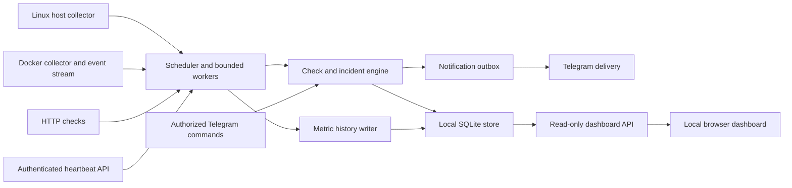

# Personal server monitoring with Telegram

Status: proposed MVP design for a standalone Go application.

See [implementation status](implementation.md) for the supported milestone and
remaining work, and [architecture](architecture.md) for the current code. This
document includes future behavior. The Makefile installs/enables a systemd unit
and starts it separately; CLI service installation remains unavailable. The
runtime keeps state in memory without the proposed durable storage/outbox.

Updated: 2026-10-15.

Project: `pi-monitoring`; command: `pi-monitor`.

## 1. Product direction

Build a packaged, extensible monitoring application for personal Linux servers, with Telegram as a primary interface and a local dashboard for resource history. Target deployments include Raspberry Pi and other small Linux servers running applications, background jobs and Docker containers. Hardware capacity and workload vary by installation.

Users run the software on their own server and supply their own Telegram bot token. No centrally operated monitoring service is required.

The system should answer:

1. Is the server healthy, and what is using its resources?
2. Are the expected applications doing their jobs?
3. What failed, how long has it failed, and has it recovered?

This document specifies proposed behavior and implementation boundaries. Updating it does not install services, change Docker, open ports, create a repository, or send Telegram messages.

### Engineering principle: keep it simple

Readability and maintainability are primary requirements. Before writing code, look for a smaller solution: remove unnecessary behavior, use the standard library, reuse suitable existing code, or choose a well-maintained dependency. The best code is code we do not need to write or maintain.

- Prefer explicit functions, concrete types and straightforward control flow. A little repetition is preferable to an abstraction that is harder to understand than the repeated code.
- Reuse code when the behavior and ownership fit. Do not build a general framework to make unrelated cases look alike, or copy an entire subsystem to reuse a small useful part.
- Add interfaces and packages for a real boundary, multiple actual implementations, or a useful test seam. Future extensibility alone does not justify them.
- Use one process, one configuration format and one local database. Add infrastructure only when an observed requirement cannot be met simply.
- Keep configuration small with documented defaults. Expose settings that change meaningful user behavior, not every internal implementation choice.
- Make errors, state transitions and permissions explicit. Simplicity must not hide failures or remove necessary correctness and security checks.
- Implement one useful path end to end before generalizing. Delete unused code and speculative extension points.

Before each implementation step, ask: can this be omitted, can existing code handle it, and can the remaining behavior be expressed more directly? Review changes for concepts and code that can be removed, as well as for correctness. These principles take precedence over speculative structure elsewhere in this document; the component names describe responsibilities, not mandatory layers, packages or services.

## 2. MVP scope

| Include in the first release | Defer |
| --- | --- |
| One Linux server, ARM64 and AMD64 builds | Multi-server hub and fleet management |
| CPU, memory, load, disk space, network and exposed temperature sensors | Broad hardware coverage, SMART integration, detailed tracing |
| Docker resource usage, health, expected-service availability and restart events | Kubernetes and other orchestrators |
| Configurable HTTP checks | Arbitrary scripts, expression languages and complex query engines |
| Application heartbeats, including periodically running scripts | Calendar-aware job scheduler and full job wrapper |
| Telegram alerts, inspection commands, acknowledgement and maintenance | Remote shell execution and container restart commands |
| Bounded local metric history and a simple dashboard | Dashboard builder and external time-series database |
| Straightforward internal code and a documented heartbeat API | Plugin frameworks and dynamically loaded executable plugins |
| Configuration generation and optional systemd installation through `init` | General-purpose installer/updater framework |

A basic Pi firmware collector for power/throttling status is a desirable optional extension. Host and HTTP monitoring must work even when Docker or Pi-specific tools are unavailable. Per-session grouping and session-specific failure detection are later extensions; general host resource graphs cover initial interactive use.

## 3. Deployment and architecture

Distribute one Go binary with embedded dashboard assets. Run it as a host systemd service by default. Keep monitored applications in their own Docker Compose projects. A host deployment makes host metrics accessible and keeps monitoring running when Docker stops.



Keep collection, evaluation, persistence and notification responsibilities understandable without turning every responsibility into an interface or package. A slow endpoint or Telegram outage must not block host collection or unrelated checks. Start with ordinary goroutines, explicit concurrency limits, context cancellation and per-operation deadlines. Introduce a worker pool or queue only where the actual execution or delivery path needs one; do not build a generic task scheduler.

A simple HTTP dashboard polls for recent state and bounded graph data. Avoid WebSocket infrastructure in the MVP unless polling demonstrably fails to meet the need. Serve embedded assets without a CDN or external login.

## 4. Configuration: YAML only

Use one YAML configuration file, normally `/etc/pi-monitor/config.yaml`. Do not implement TOML or JSON configuration loaders. JSON remains appropriate for HTTP responses and heartbeat payloads; it is not a configuration format.

All configuration decodes into typed Go structures and passes the same validator. Reject unknown fields, duplicate keys, duplicate IDs, invalid durations, incompatible assertion types and unsupported schema versions. Report the offending check and field. Do not silently ignore a typo.

Duration fields use strings such as `"30s"`, `"5m"` and `"24h"`. Quote textual values in published examples. Schema version 1 defines defaults and validation; example values below are proposed settings, not an already implemented interface.

```yaml
schema_version: 1

server:
  name: "home-pi"
  listen: "127.0.0.1:8088"

dashboard:
  enabled: true

storage:
  path: "/var/lib/pi-monitor/monitor.db"
  retention: "7d"
  budget: "1GiB"
  flush_interval: "60s"

telegram:
  enabled: true
  token_env: "PI_MONITOR_TELEGRAM_TOKEN"
  allowed_chat_ids: [123456789]
  allowed_user_ids: [987654321]
  alert_chat_ids: [123456789]

host:
  enabled: true
  interval: "10s"
  mounts: ["/"]

alerts:
  startup_grace: "120s"
  critical_repeat_interval: "1h"

host_rules:
  - id: "low-memory"
    metric: "host.memory.available_bytes"
    operator: "lt"
    value: 524288000
    for: "5m"
    recovery:
      operator: "gte"
      value: 629145600
      for: "2m"

docker:
  enabled: true
  socket: "/var/run/docker.sock"
  interval: "30s"
  expected_services:
    - id: "example-bot"
      compose_project: "example"
      compose_service: "bot"
      replicas: 1
      startup_grace: "120s"

heartbeats:
  - id: "daily-utility"
    max_age: "25h"
    initial_grace: "25h"
    token_env: "PI_MONITOR_DAILY_UTILITY_TOKEN"

http_checks:
  - id: "example-api"
    url: "http://localhost:8080/health"
    interval: "30s"
    timeout: "5s"
    expect:
      status: 200
      json:
        - pointer: "/status"
          operator: "eq"
          value: "healthy"
        - pointer: "/dependencies/database/ready"
          operator: "eq"
          value: true
    alert:
      failures: 3
      recovery_successes: 2
```

This example binds to loopback as a safe installation default. For a LAN deployment, explicitly change `server.listen` to its reserved LAN address and restrict access to the trusted subnet. There is no remote dashboard requirement.

Use named environment-variable references for credentials, rather than unrestricted interpolation across configuration. Missing required variables are configuration errors. Redact credential values and sensitive request headers in diagnostics.

Startup validation and a controlled service restart are sufficient for the MVP; hot reload is deferred. Persisted acknowledgement and maintenance state do not require editing the YAML file.

## 5. HTTP check definition

Each HTTP check follows this pipeline:

**Request → status assertion → optional body extraction → assertions → result → incident state.**

Required fields are a unique `id`, HTTP(S) `url` and positive `interval`. Defaults are `method: "GET"`, `timeout: "5s"`, `follow_redirects: false`, a 1 MiB response-body limit and expected status 200. Require timeout to be shorter than interval. Only GET and HEAD are supported initially; HEAD cannot declare body assertions.

Optional headers support ordinary literal values and explicitly referenced environment values for credentials. Do not log Authorization, cookies, secret query parameters or whole response bodies. HTTPS certificate verification remains enabled; custom trust configuration is a later addition.

Use Go's HTTP client with explicit timeout and redirect behavior, reused connections and properly closed response bodies. Set redirect policy deliberately because client behavior is configurable. [Go HTTP client documentation](https://pkg.go.dev/net/http#Client).

Supported assertions:

| Target | Configuration | Operators |
| --- | --- | --- |
| HTTP status | `expect.status` | Exact integer equality |
| Whole text body | `expect.text` list | `eq`, `contains` |
| Selected JSON value | `expect.json` list | `eq`, `ne`, `exists` |
| Selected JSON number | `expect.json` list | `gt`, `gte`, `lt`, `lte` |

Select JSON values using JSON Pointer, including nested fields and array elements such as `/workers/0/ready`. Follow the standard escaping rules for `/` and `~` in key names. [JSON Pointer specification](https://www.rfc-editor.org/rfc/rfc6901).

All assertions must pass. Configure either text or JSON body assertions, not both. Status-only checks do not require valid JSON. Text comparisons are case-sensitive and exact; whitespace is not stripped implicitly.

For JSON:

- Preserve scalar types. Boolean `true` differs from string `"true"`; strings are never converted to numbers implicitly.
- Numeric equality compares numeric values, so JSON `1` and configured `1.0` are equal. Preserve enough numeric precision to avoid float-rounding mistakes with large integers.
- `exists` requires `value: true` or `value: false`. A present JSON null counts as existing. Equality to null is supported; object/array equality is deferred.
- A missing pointer fails ordinary comparison, including `ne`; it does not accidentally pass as "not equal".
- Invalid JSON, duplicate JSON object keys, incompatible types and oversized bodies produce an explicit evaluation failure, never healthy status.

Additional text example:

```yaml
http_checks:
  - id: "plain-health"
    url: "http://localhost:9000/health"
    interval: "1m"
    timeout: "5s"
    expect:
      status: 200
      text:
        - operator: "contains"
          value: "ready"
    alert:
      failures: 3
      recovery_successes: 2
```

Do not add shell commands, JavaScript, regex extraction, JSONPath filters or arbitrary expressions to the MVP. The evaluator can gain new assertion types later through explicit schema additions.

## 6. HTTP scheduling and result semantics

Execute a first check after a small startup stagger, then schedule by monotonic intervals. Do not overlap executions of the same check or build an unbounded backlog. If worker capacity is exhausted, record a missed execution as monitoring degradation; do not claim the endpoint failed without making a request.

A result contains check ID, timestamp, outcome, elapsed time, status code where available, assertion outcomes and a sanitized reason. Distinguish connection/DNS errors, timeout, unexpected status, invalid body, missing field, type mismatch and value mismatch.

Three consecutive completed failed evaluations open the example incident. Two consecutive successful evaluations recover it. A successful evaluation resets the failure streak. A failed evaluation resets the recovery streak. Missed or unknown evaluations break streaks and produce stale-monitoring status; they never count as successful recovery.

With a 30-second interval, the third failure is approximately 60 seconds after the first failed sample, plus request execution time. The elapsed time from the actual fault depends on where it falls between checks. Expose failure count and first-failure time rather than promising exact detection latency.

Store response latency and availability history, but not complete HTTP response bodies. Full URL and header values are not needed in Telegram messages.

## 7. Host and Docker collection

The host collector reads CPU usage, available memory, swap, load, uptime, disk space/inodes, network rates and accessible temperature sensors. Compute rates from deltas and handle counter resets. Linux available memory is more useful than treating filesystem cache as unavailable RAM. Define CPU percentage consistently: 100% means all host CPU capacity is used.

Disk alerts watch configured real filesystems. Exclude pseudo-filesystems and duplicate Docker overlay mounts. Unsupported temperature or power sensors are unavailable, not zero. A Pi extension distinguishes current firmware flags from historical flags that may remain set after recovery. [Raspberry Pi firmware utility documentation](https://www.raspberrypi.com/documentation/computers/os.html#vcgencmd).

The Docker collector uses the local Engine API for stats, inspect/list operations and events, with timeouts and reconnect backoff. Reconcile periodic reads with events so fast restart activity is not lost between polls.

Match expected services by Compose project/service labels and declared replica count. Keep stable service identity across container recreation. A removed expected container remains visible as missing. A successful one-shot container is not automatically a failed long-running service; register periodic jobs as heartbeats instead.

If Docker becomes unavailable, open one Docker incident and mark dependent container checks unknown. Host and HTTP checks continue. An application explicitly disabled in configuration is excluded from availability expectations; an enabled stopped application still alerts unless maintenance is active.

Docker inspection requires socket access, which is effectively privileged even with a read-only bind mount. Use a dedicated service identity, inspect-only application code and a narrow local API; do not describe socket access as a security boundary.

## 8. Application heartbeats

Provide a small authenticated endpoint:

```text
POST /api/v1/heartbeats/{id}
Authorization: Bearer <per-check token>
```

Example JSON payload:

```json
{
  "status": "ok",
  "message": "completed successfully",
  "duration_ms": 1250
}
```

Only registered IDs are accepted. Each token authorizes its own heartbeat. Enforce body limits and do not echo secrets. Use the server's receipt time for freshness; a client-supplied timestamp must not keep a failed program healthy.

A bot sends a successful heartbeat only after its main loop progresses. Empty successful polls count as progress; an independent timer must not conceal a stuck main loop. Set `max_age` beyond long-poll and retry timeouts.

A periodic script sends success after completion, or `status: "fail"` when it can report failure. Successful receipts refresh last-success time; failed receipts record failure without refreshing last success. `initial_grace` defines when a never-seen heartbeat becomes overdue. Malformed requests are rejected and do not count as progress.

For the MVP, freshness uses a maximum elapsed interval, not a cron/calendar expression. The 25-hour example tolerates modest drift for a daily task but does not implement "every day at 03:00" semantics. Calendar-aware schedules, overlapping-run detection and a wrapper that captures silent crashes are later additions.

Bind/access configuration must allow monitored containers to reach this endpoint. Container localhost is not the host. Document the chosen host address or host-gateway arrangement and authenticate it; localhost-only dashboard settings alone are insufficient for container push access. The dashboard and heartbeat routes can share one configured listener, with route-specific authorization. A loopback Unix/CLI reporting option can be added later.

## 9. Incident engine and alert policy

Separate observations from incidents. Track `unknown`, `healthy`, `pending`, `firing` and `recovering` evaluation states, plus incident lifecycle history. Missing data is never silently healthy.

HTTP assertions use consecutive result counts. Metric rules use threshold duration and recovery hysteresis. For sample-based rules, reset a duration window on a gap longer than twice the configured collection interval; unknown data cannot prove a condition continuously held.

Initial Pi thresholds are engineering preferences to tune, not hardware specifications:

| Condition | Initial trigger | Recovery |
| --- | --- | --- |
| Temperature | Above 75 °C for 5 minutes | Below 70 °C for 2 minutes |
| Available memory | Below 500 MiB for 5 minutes | Above 600 MiB for 2 minutes |
| Free space | Below 15% or 10 GiB for 5 minutes | Above trigger with a configured margin |
| CPU utilization | Above 90% for 10 minutes | Below 80% for 2 minutes |
| Expected container missing | 120-second startup grace, then 60 seconds missing | Healthy across two observations |
| Docker unhealthy | Unhealthy for 2 minutes | Healthy across two observations |
| Restart loop | At least 3 unexpected restarts in 10 minutes | No additional unexpected restarts for 10 minutes |
| Bot heartbeat | Older than configured maximum age | Fresh success heartbeat |
| Periodic script | Failed receipt or overdue successful heartbeat | Next successful completion |
| HTTP check | 3 consecutive failed evaluations | 2 consecutive successful evaluations |

Version 1 supports one firing severity per configured rule. Separate critical rules can be added later; the example thresholds above are warning rules. Deduplicate on stable rule/check identity. Notify when an incident opens and when it recovers, including duration. Repeat only incidents configured as critical, no more than once per hour by default.

Acknowledgement stops reminders for the current incident; it does not declare recovery. Maintenance is scoped to an entity with a reason and expiry, suppresses notifications while collection continues, and does not erase incident state. On expiry, notify once if an unresolved incident remains.

Persist incident transitions, acknowledgement and maintenance. After restart, retain incident identity but revalidate current health before sending recovery. Avoid repeating the original opening alert on every process restart. Dependency outages suppress derivative alerts and produce unknown status.

## 10. Telegram integration

Each installation supplies its own bot token and authorized chats/users. Reuse existing Telegram bot code only after reviewing its boundaries, dependencies, license and suitability for redistribution. Do not import project-specific data, credentials or assumptions. Wrap the transport behind a notifier/command interface.

Use long polling for commands, so no public webhook or inbound Telegram port is needed. One running poller owns a token; document that another application cannot simultaneously use that bot's update stream. [Telegram Bot API](https://core.telegram.org/bots/api#getupdates).

MVP commands:

| Command | Behavior |
| --- | --- |
| `/status` | Host summary, failing checks and data freshness |
| `/containers` | Expected application states and resource summary |
| `/checks` | HTTP and heartbeat status |
| `/incidents` | Active incidents with IDs and age |
| `/ack <incident-id>` | Acknowledge an active incident |
| `/silence <entity-id> <duration>` | Create temporary maintenance |
| `/unsilence <entity-id>` | End maintenance |
| `/help` | Command descriptions and examples |
| `/reboot` | Optional host reboot with a one-time, 60-second confirmation |

Authorize every command and callback using configured chat and user IDs. This matters particularly in groups. Notification destinations are separate from command authorization. Commands inspect status or manage monitoring notifications. The explicitly enabled `/reboot` command is a narrow host-control exception: it requires confirmation from the same user in the same chat and a separate OS reboot permission. It invokes a fixed systemctl operation without a shell. Arbitrary remote execution and application-container control remain excluded.

Incident messages include server, entity, reason, threshold or expected value, first-failure time and a short suggested check. Sanitize dynamic text, bound message size and avoid credentials, raw logs or response dumps.

Use a durable bounded notification outbox with retry/backoff, Telegram retry-after handling and per-destination deduplication. Assume at-least-once delivery: a network failure after a successful send may produce a duplicate. Cap queued messages and coalesce old transitions into a current-state summary after a prolonged outage; do not silently discard the only record of an unresolved critical incident. Notification failures appear in the dashboard and logs, not through recursive Telegram alerts.

## 11. Dashboard and local API

Provide a simple read-only dashboard with:

- Host overview and CPU/memory/network/disk graphs.
- Per-service Docker resource graphs and availability.
- HTTP latency, result history and assertion failure reasons.
- Heartbeat freshness and last successful receipt.
- Active/recent incidents, acknowledgement and maintenance indicators.
- Monitoring collection freshness, storage use and notification delivery status.

Use stable series IDs and bounded time ranges; avoid unlimited chart creation for short-lived containers. Missing samples render as gaps. Availability percentages report coverage/unknown intervals rather than treating missing observations as success.

MVP ranges can be 1 hour, 24 hours and 7 days. Limit points returned per series and aggregate long ranges for rendering. Embedded static assets require no external service; record third-party frontend licenses.

Default binding is loopback. For a LAN deployment, reserve a stable LAN address, bind deliberately and permit only the trusted subnet, considering IPv4 and IPv6. No router forwarding or public dashboard exposure. An untrusted LAN requires a local authenticated reverse proxy before exposure; remote access is outside current scope.

Keep heartbeat ingestion authenticated and prevent it from mutating configuration or unrelated checks. Administrative state changes happen through authorized Telegram commands or the local CLI, not a broadly writable web API.

## 12. History and storage

Use embedded SQLite as the initial local store: no separately managed database process. Select a Go driver after checking ARM64/AMD64 packaging, license and the SQLite version it bundles. Pin dependencies and use a current patched SQLite release.

Store timestamped metric batches, check results, incident transitions, current operational state and a bounded notification outbox. Batch disposable samples approximately every minute; persist important state/outbox transitions promptly. Live status comes from memory and is not delayed until the next batch.

Use one writer path, bounded transactions and short dashboard read queries. WAL mode is a candidate to allow reading alongside writes, but checkpointing and long readers require care; monitor the database and its sidecar files together. [SQLite WAL documentation](https://www.sqlite.org/wal.html).

Retain up to 7 days of history under a 1 GiB storage target. Enforce age and row/byte budgets in cleanup batches; deletion alone does not shrink a database file. Reuse freed pages, constrain growth, bound WAL size through checkpoint policy and test file-size behavior. Do not run full vacuum on every cleanup pass. Retain necessary active incident state independently of metric expiry.

Document durability tradeoffs: an abrupt power loss may lose the latest unflushed metric samples. Avoid claiming exactly-once notifications or perfect incident persistence across hardware failure. If storage fails, keep bounded live monitoring and best-effort alerts running, surface degraded persistence, and avoid unlimited buffering or log spam.

## 13. Resource and microSD budgets

Targets are to be measured on the real Pi, not claimed performance:

| Item | Initial target |
| --- | --- |
| Host metrics | Every 10 seconds |
| Docker metrics/state | Every 30 seconds, plus event observation |
| HTTP checks | Per check; example 30 seconds |
| Dashboard refresh | Every 10 seconds |
| Metric flush | Every 60 seconds |
| Stored history | Up to 7 days, 1 GiB target |
| Total monitoring directory review threshold | 2 GiB including database sidecars |
| Steady process memory | Aim below 100 MiB; investigate sustained usage above 150 MiB |
| Idle CPU overhead | Aim below 2% of one core over 10 minutes |
| Validation load | Ordinary workloads, around 10 checks and one dashboard viewer |

Keep runtime samples and heartbeat freshness in memory. Write metrics in batches and operational state on transitions. Bound logs, series cardinality, queues, response sizes and query ranges. Measure disk writes before and after deployment. Card capacity does not establish endurance or remaining life; do not promise unavailable SD health metrics.

Cap persistent journal use after inspecting existing requirements, initially considering 200 MiB. Metric history is disposable; configuration and useful incident state are more valuable. Back up configuration to another device when a destination exists, handling credentials separately.

## 14. Docker application convention

Monitored long-running applications should declare health checks, restart policy, measured memory limits and rotated logs. Example template:

```yaml
services:
  bot:
    image: "example-bot:VERSION"
    restart: unless-stopped
    mem_limit: "256m"
    healthcheck:
      test: ["CMD", "python", "-m", "app.healthcheck"]
      interval: 30s
      timeout: 5s
      retries: 3
      start_period: 60s
    logging:
      driver: local
      options:
        max-size: "10m"
        max-file: "3"
```

Adapt image, command and limits to each application. 256 MiB is illustrative; Docker imposes no resource limits unless configured. [Resource constraints](https://docs.docker.com/engine/containers/resource_constraints/).

A running unhealthy container is not automatically restarted merely because its health check fails. Restart policies handle exits. The monitor reports problems and does not perform blanket restarts. [Compose service reference](https://docs.docker.com/reference/compose-file/services/).

Log rotation limits growth; existing containers need recreation to pick up changed logging settings. Use Docker to read logs rather than accessing internal log files. [Local logging driver](https://docs.docker.com/engine/logging/drivers/local/).

## 15. Extensibility without a framework

Start with concrete Go functions and types for collectors, checks, incident evaluation, SQLite storage and Telegram delivery. Share a small result model where it makes the incident logic simpler. Keep collection code free of Telegram formatting.

Extract an interface only when a real caller benefits from substituting implementations or a meaningful test needs a boundary. A notifier interface or injectable time function may be useful; a repository layer over a single SQLite implementation is not required. Tests should not force a hierarchy of otherwise unused abstractions.

Built-in extensions compile into the binary. External applications use the versioned heartbeat HTTP contract. Do not create plugin discovery, registration factories, a dependency-injection container or a generic event bus in anticipation of future integrations. Add a new check directly first; generalize only when actual implementations reveal a useful common boundary.

Publish metric units, CPU semantics, assertion behavior and freshness rules. Extensibility should come from clear responsibilities and documented contracts, with no public internal-plugin compatibility promise in the MVP.

## 16. Monitoring the monitor

Provide `/healthz` for process liveness and `/readyz` for initialized configuration/store availability, plus internal collector freshness metrics. A Docker outage alone must not make host monitoring unready. Dashboard freshness checks reveal a stuck collector even when the process responds.

Run under systemd with bounded restart backoff. Graceful shutdown cancels workers, flushes bounded state and exits within a deadline. Optional systemd watchdog support or a separate local watchdog can detect a stuck process; independent direct notifications are a later enhancement, not another MVP daemon.

A fully powered-off or disconnected Pi cannot send an immediate Telegram alert. External heartbeat monitoring is a future option that does not require exposing the dashboard.

## 17. CLI, files and repository

Proposed CLI:

```text
pi-monitor init
pi-monitor init --output ./config.yaml --docker --no-dashboard
sudo pi-monitor init --install --dry-run --docker
sudo pi-monitor init --install --start --docker --no-dashboard
pi-monitor run --config /etc/pi-monitor/config.yaml
pi-monitor validate --config /etc/pi-monitor/config.yaml
pi-monitor check example-api --config /etc/pi-monitor/config.yaml
pi-monitor version
```

`validate` performs local schema checks without network activity. `check` evaluates one HTTP check once, prints sanitized assertion results, uses meaningful exit codes and sends no notification. `run` starts the configured components. Include a shutdown path and clear startup errors.

### Initial configuration and service installation

`init` without installation flags writes a commented `config.yaml` in the current directory, or to `--output`. It does not require root, install a service or start monitoring. Generate a useful host-monitoring configuration with default alert rules and commented examples for optional checks.

| Initial component | Default |
| --- | --- |
| Host collection and basic host alert rules | Enabled |
| Docker monitoring | Disabled; enable using `--docker` |
| Dashboard | Enabled on loopback; disable using `--no-dashboard` |
| Telegram | Disabled until a token and authorized destinations are configured |
| HTTP checks | Empty; include commented examples |
| Heartbeats | Empty; configure only when needed |

Flags generate ordinary YAML settings; runtime behavior comes from that file. Docker remains controlled by `docker.enabled`, and the dashboard by `dashboard.enabled`. Avoid a symmetric enable/disable flag for every setting: the two flags above cover the initial installation choices. Users edit YAML for other settings.

`--no-dashboard` disables UI routes and chart-query work, not host collection, alerts, or configured heartbeat ingestion. Start the HTTP listener only when the dashboard, configured heartbeats, or another enabled HTTP feature needs it. Health endpoints are available when the listener runs; they do not require keeping an otherwise unused server running in Telegram-only mode. Keep metric history retention unchanged unless the user explicitly changes storage settings.

`init --install` requires root and a systemd host. It validates the proposed configuration, installs the current binary to a stable path, creates a dedicated service identity and restricted directories, and writes a systemd unit and environment-file template. Use the fixed system paths below for this mode; `--output` applies only to configuration generation.

Installation reloads systemd and enables the unit for boot. Starting it now requires `--start`, which is valid only with `--install`. `--dry-run` shows proposed file changes, permissions, feature choices and systemd actions without mutating anything; it can be used without root for planning. Do not install Docker, open firewall ports or contact Telegram as a side effect.

Preserve existing configuration, secrets, database and unit files. Repeated initialization reports existing files and stops before conflicting writes; do not add a blanket force-overwrite option to the MVP. Preflight permissions, paths and prerequisites before changes. If an action fails, report completed steps and leave existing data intact rather than claiming installation succeeded.

Enabling Docker requires explicitly granting the service identity inspection access to the existing socket; explain the associated host privileges in dry-run output and installation documentation. If Docker/socket prerequisites are missing, fail clearly without silently disabling the requested feature. Do not require Docker when the feature is disabled.

Store Telegram credentials in the restricted environment file, never in command-line token flags or generated example YAML. `run` and `check` load a private regular `secrets.env` file beside the selected configuration, importing only referenced credentials and preserving explicitly set process environment variables. The file is optional, but an invalid existing file stops runtime startup before network requests. Values are literal assignments, never shell code. `validate` remains independent of credentials and does not read this file. Credential setup can initially be a documented file edit; an interactive setup wizard and an uninstall command are later conveniences. Keep `init` as a small, explicit set of file and systemd operations, not a package manager or upgrade engine.

| Deployment path | Purpose |
| --- | --- |
| `/etc/pi-monitor/config.yaml` | Sole application configuration |
| `/etc/pi-monitor/secrets.env` | Restricted environment values for systemd |
| `/var/lib/pi-monitor/monitor.db` | History, incidents and outbox |
| `/usr/local/bin/pi-monitor` | Release binary |
| `pi-monitor.service` | Host service |

Start with a small command entry point and a few cohesive internal packages, plus embedded assets, examples and service templates. Split packages when the code becomes easier to navigate, not to match every box in the architecture diagram. Prefer standard library facilities and reuse suitable existing Telegram code; add dependencies only where they clearly remove more complexity than they introduce.

For an open-source release, include a license, README, example YAML, architecture overview, installation/uninstall instructions, privacy/permission notes, contribution guidance and CI. Publish ARM64 and AMD64 artifacts with checksums. Audit licenses before reusing existing bot code or bundling dependencies. Do not publish private configuration or tokens.

## 18. Implementation phases

### Phase 1: config and HTTP checks

Create the Go project, schema/strict YAML loader, CLI validator, one-shot checker and result model. Implement status/text/JSON Pointer assertions with local HTTP fixtures. Add configuration-only `init` using the same defaults and validation. This establishes a useful feature before dashboard work. Review what can be omitted or reused before adding abstractions.

### Phase 2: incidents and Telegram

Add timed scheduling, bounded workers, incident transitions, acknowledgement/maintenance and notification delivery. Use the user's token and allowlists. Test delivery with a real bot only when implementation explicitly includes that action.

### Phase 3: server metrics and Docker

Implement host metrics, optional sensors, Docker stats/events and expected-service checks. Isolate unavailable collectors. Deploy on the Pi and measure overhead.

### Phase 4: history, dashboard and heartbeats

Add the SQLite store, batching/cleanup, embedded local charts and authenticated heartbeat endpoint. Verify container connectivity and daily-script behavior. Measure storage growth, writes and dashboard queries over at least 24 hours.

### Phase 5: release quality

Add `init --install`, feature flags and dry-run output using the existing configuration generator. Run a week-long real deployment, tune alerts, document actual resource usage, audit dependencies and prepare reproducible release packaging. Review the implementation for unnecessary code, options, abstractions and dependencies before publishing. The first public MVP includes the functional phases and installation path; partial prototypes should be labeled accordingly.

## 19. Acceptance checks

| Scenario | Expected outcome |
| --- | --- |
| Unknown YAML key, duplicate ID or invalid duration | Startup/validation fails with a useful field error |
| TOML configuration supplied | Unsupported format; no second loader |
| `init` without root or installation flags | Only initial YAML is generated; no system changes |
| `init --install --dry-run` | Planned changes printed; no files, permissions or services changed |
| Existing configuration or installation files | Preserved; conflicts explained before writes |
| `--docker` with missing prerequisites | Clear failure; feature not silently ignored |
| `--no-dashboard` with configured heartbeats | UI disabled; authenticated heartbeats still work |
| Telegram-only mode without HTTP features | No unnecessary HTTP listener; monitoring and alerts work |
| Install without `--start` | Service enabled for boot but not started now |
| HTTP response matches every assertion | Healthy result with latency |
| Wrong status, missing field or type mismatch | Failed result identifies the reason |
| JSON numeric/string/boolean/null cases | Documented comparisons hold without coercion |
| Timeout, TLS error or oversized body | Bounded failure, other checks continue |
| Slow endpoint or saturated workers | No overlapping execution or unbounded backlog |
| Three HTTP failures then two successes | One opening alert and one recovery alert |
| Unknown/missed evaluations | No false healthy status or recovery |
| Unauthorized Telegram user or callback | No status disclosure or state mutation |
| Acknowledgement or maintenance | Suppression works without erasing health state |
| Telegram outage or rate limit | Bounded retry; current-state summary after recovery |
| Process restart during incident | Identity/state restored without reopening spam |
| Expected container removed or restarted rapidly | Missing/restart-loop detection remains reliable |
| Docker daemon unavailable | One Docker incident; host and HTTP checks continue |
| Bot quiet but progressing | Healthy heartbeat despite no user messages |
| Script fails or stops reporting | Failure/overdue incident; success recovers |
| Forged or malformed heartbeat | Rejected; last-success time does not advance |
| Open local dashboard without internet | Embedded UI and graphs work |
| Storage error or sustained retention pressure | Bounded growth/buffers and visible degradation |
| Ordinary Pi load plus one dashboard viewer | Measured resource targets met or documented/tuned |

Use deterministic clock tests for alert timing, HTTP test servers for assertion cases, Docker fixtures/test containers for lifecycle cases, and integration tests for storage/restart behavior. Simulate temperature and low-space signals; do not overheat the Pi or fill its root filesystem.

## 20. Settled decisions and remaining choices

Settled: simplicity and maintainability before speculative extensibility; standalone Go application; one Linux host initially; bring-your-own Telegram bot token; optional local-only dashboard; YAML as the sole configuration format; HTTP checks in the MVP; JSON Pointer for JSON extraction; declarative typed assertions; `init` for configuration and optional systemd installation; explicit Docker enablement; and no arbitrary remote execution commands. Optional, confirmed host reboot is the sole host-control command.

Remaining implementation choices include final name/license, dependency selection, reused Telegram code boundaries, chart library, concrete database schema, filesystem/network deployment details and measured thresholds. They do not require changing the agreed product direction.
